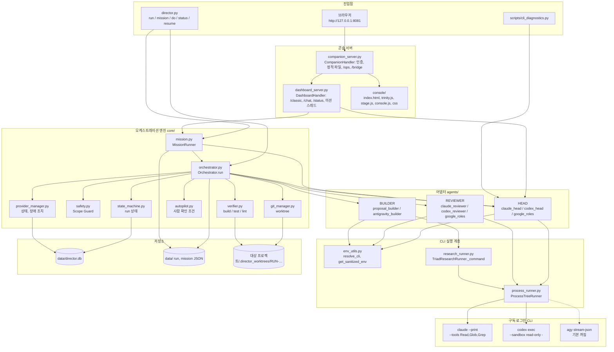
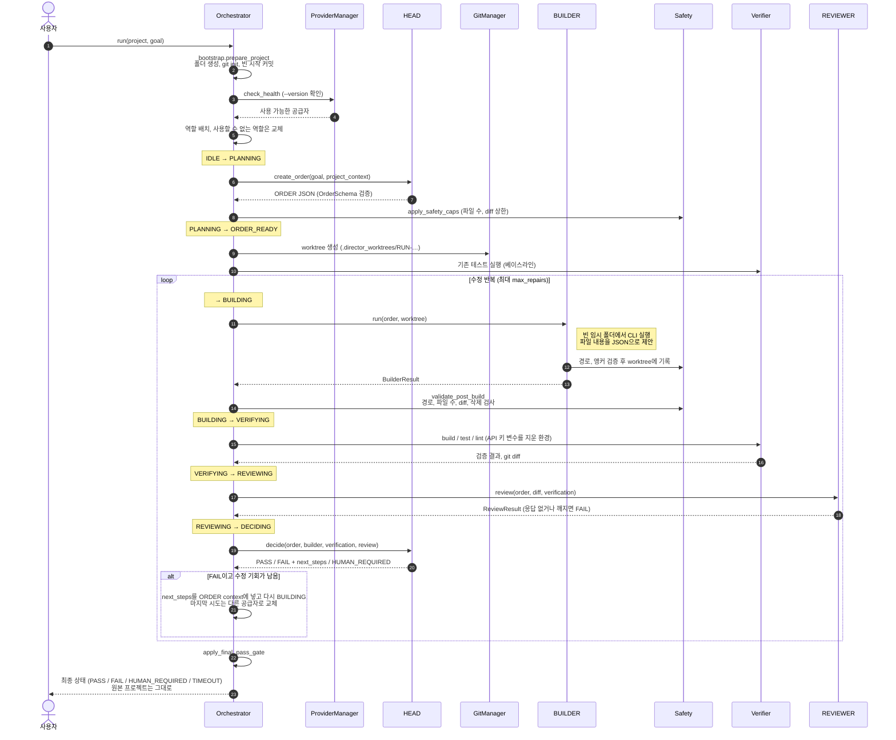
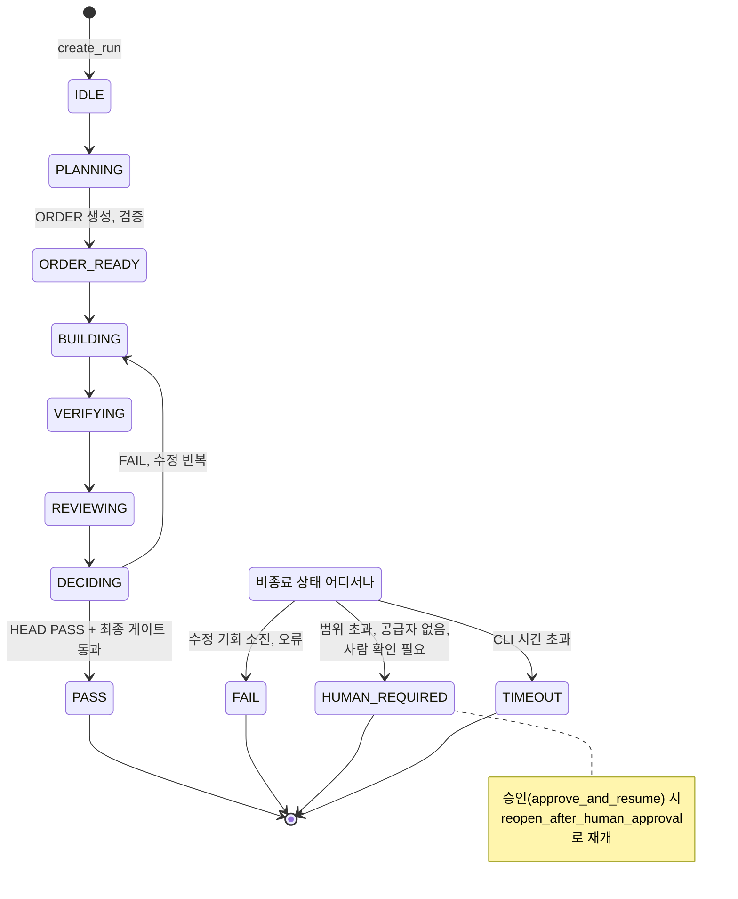
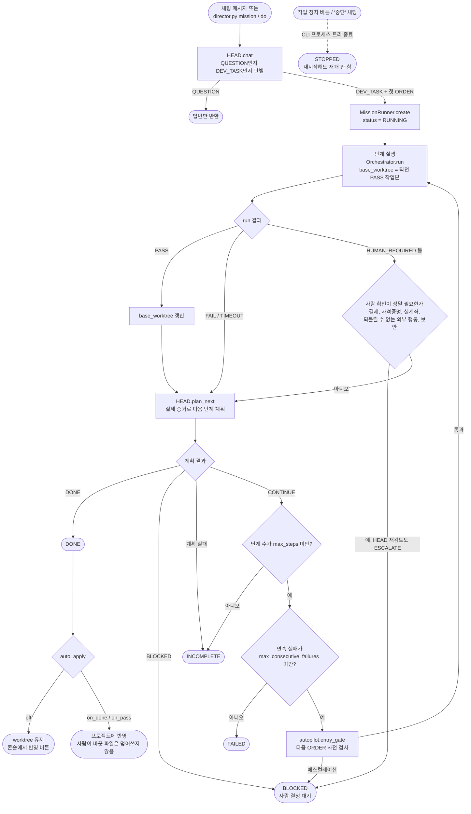
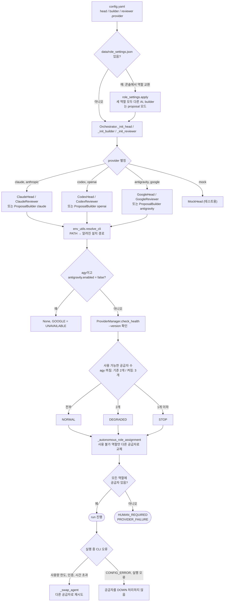
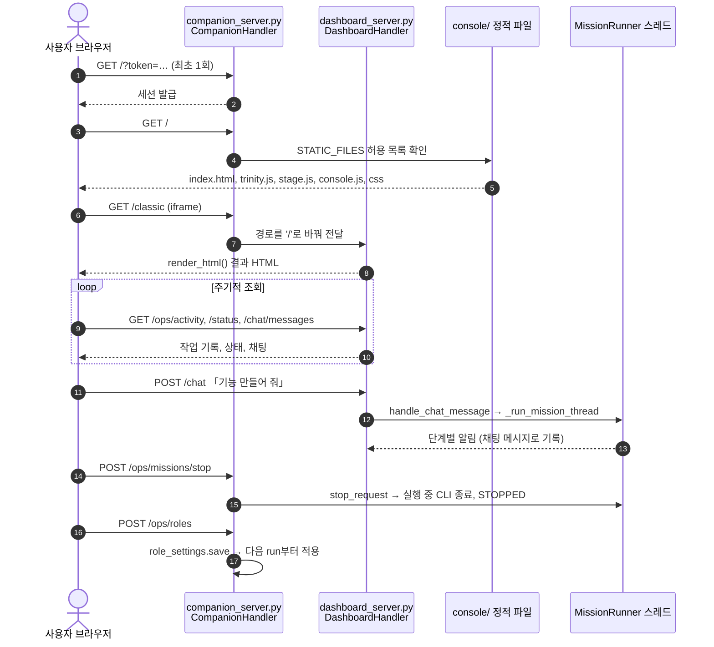

# AI DEV DIRECTOR 전체 플로우 (Mermaid)

> 기준 커밋: `be90907` (v3.2.0) · 함께 보기: [PROJECT_ANALYSIS.md](PROJECT_ANALYSIS.md)
> GitHub, VS Code(Markdown Preview Mermaid Support 확장), Obsidian 등에서 바로 렌더링됩니다.

목차
1. 전체 구조: 진입점 → 엔진 → 어댑터 → CLI
2. 단일 run 파이프라인 (시퀀스)
3. run 상태 머신
4. 미션 루프
5. 역할 배치와 공급자 장애 조치
6. 콘솔 요청 흐름

---

## 1. 전체 구조

---

## 2. 단일 run 파이프라인

`core/orchestrator.py::Orchestrator.run` 기준입니다. 기본 역할: HEAD=Claude, BUILDER=Codex(proposal 모드), REVIEWER=Claude.

---

## 3. run 상태 머신

`core/state_machine.py`의 `VALID_NORMAL_TRANSITIONS`와 `can_transition` 기준입니다.

---

## 4. 미션 루프

`core/mission.py::MissionRunner._advance` 기준입니다. 미션 상태: `RUNNING`, `DONE`, `BLOCKED`, `INCOMPLETE`, `FAILED`, `STOPPED`.

---

## 5. 역할 배치와 공급자 장애 조치

---

## 6. 콘솔 요청 흐름

